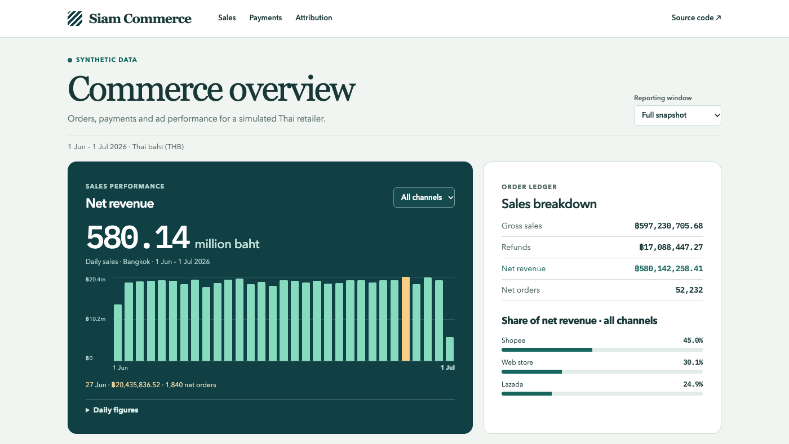
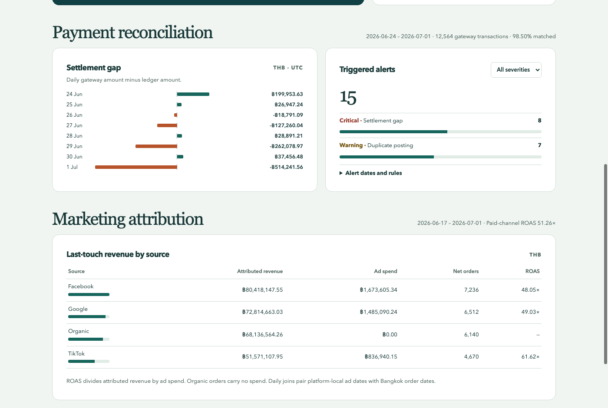

# Siam Commerce

I built this project to understand what happens to a sales report when a shop gets a late refund, a payment gateway disagrees with the ledger, or an ad file arrives a day late. I generated the orders, payments and ad records for one fictional Thai retailer so I could follow the same sales through all three reports.

[Open the live commerce dashboard](https://data-platform-amber.vercel.app/)

Siam Commerce follows **60,000 simulated orders** from June 1–30, 2026 (2,000 per day). The full snapshot shows **580.14 million baht** in net revenue. **Sales breakdown** gives the exact amount, ฿580,142,258.41, from 52,232 paid, shipped or delivered orders. Select a bar for one day’s sales, or open **Daily figures** to see the amounts and refunds side by side.

Choose **Last 7 days** to compare sales, payment alerts and ad spend over the same dates. The settlement chart shows which side recorded more money each day. Under **Marketing attribution**, each source’s credited revenue sits alongside its ad spend. **Snapshot scope** lists the dates for all three feeds, covering 30 days of orders, 7 of payments and 14 of ads. Order and settlement activity extends into July 1 because the reports use Bangkok order dates and UTC settlement dates.

| Sales and refunds | Payments and marketing |
|---|---|
|  |  |

## How to read the numbers

- **Sales.** I count an order with three items once and add up the value of all three items. If the shop later refunds that order, its value comes out of net sales on the original sale date. [Order pipeline](pipelines/orders/README.md) · [Refund example in Thai](docs/blog/refund-restatement-th.md)
- **Payments.** The pipeline compares what the gateway recorded with what the shop posted to its ledger. It checks fees, rounding and payments posted after midnight. A payment recorded on only one side appears in the follow-up report. [Matching rules](pipelines/reconciliation/README.md)
- **Marketing.** I credit each eligible order to one source. For example, if an order carries a Google tag, I count its net sales under Google. The tag alone cannot tell me whether an ad led to the sale. An order with no campaign source counts as organic. Return on ad spend divides credited revenue by ad spend. Both the tags and spend are simulated, and each platform reports spending in its own time zone. [Marketing assumptions](pipelines/marketing/README.md)

## Run it locally

To explore the saved dashboard, run this from the repository root and open `http://127.0.0.1:8000`. Python’s built-in web server is enough.

```bash
python3 -m http.server 8000 --bind 127.0.0.1 --directory dashboard
```

**To reproduce the published 60,000-order dashboard**, use Python 3.11. The rebuild generates the source files, runs all three pipelines and their tests in a temporary workspace, and writes the [dashboard snapshot](dashboard/data/snapshot.json).

```bash
python3.11 -m venv .venv
source .venv/bin/activate
python -m pip install -r requirements.txt
python scripts/rebuild_snapshot.py
```

**To keep a DuckDB warehouse for SQL**, run the stages below from a fresh checkout with the same Python environment. The order generator defaults to **600,000 orders** (20,000 per day for 30 days). The last command includes the late TikTok delivery.

```bash
python generator/generate_orders.py
python generator/generate_payments.py
python generator/generate_marketing.py
python pipelines/orders/run_pipeline.py --all --skip-tests
python pipelines/reconciliation/run_recon.py --all
python pipelines/marketing/run_marketing.py --all --include-late
```

Open `warehouse/platform.duckdb` to try the [example queries](pipelines/orders/example_queries.sql). Each run also writes [reports](reports/). dbt builds the sales and marketing tables. The optional [Airflow setup](docker-compose.yml) schedules the pipelines locally with Docker. Use separate warehouse files for the local and container versions of DuckDB, and run writes to each file one at a time.

## Verification

After building a warehouse, run `python -m pytest -q tests/`. All 81 cases passed on the published 30-day sample. The three-day CI sample skips one check that needs eight days of history. CI also checks the dashboard in Chromium at desktop and phone widths, including exact amounts, keyboard selection, filters and dates with no payment or marketing data. [CI results](https://github.com/Tasachii/Siam-Commerce/actions/workflows/ci.yml)

[MIT license](LICENSE) © 2026 Phasathat Jaruchitsophon. IBM Plex Mono is included under the [SIL Open Font License 1.1](dashboard/fonts/OFL.txt).
